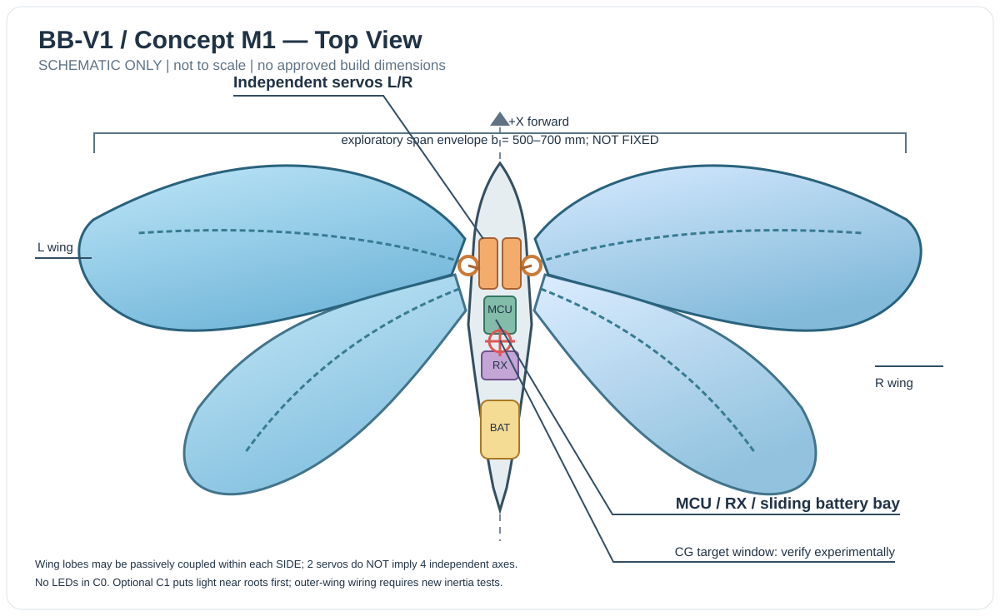
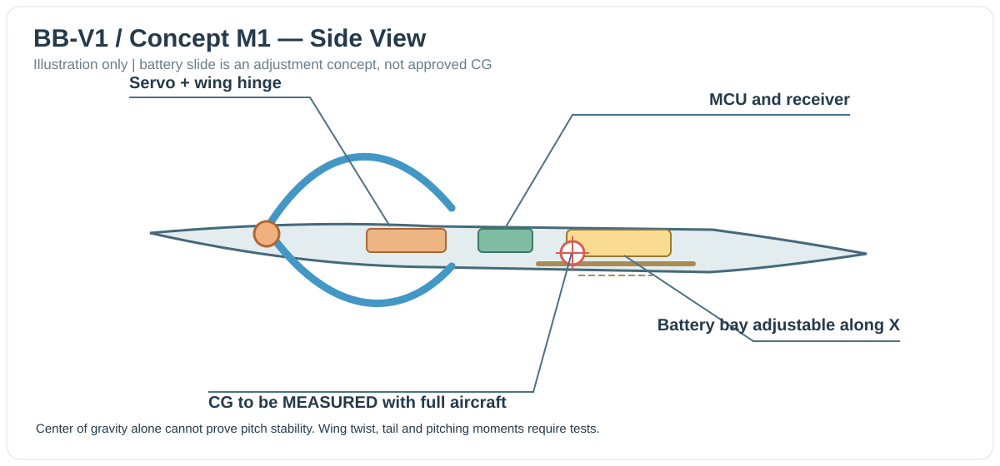

# BionicButterfly — Thiết kế concept cơ khí M1 cho V1 RC Flight

- **Document ID:** BB-MECH-CONCEPT-019
- **Version:** 0.2 · 2026-11-12
- **Owner:** Solution Architect
- **Status:** **PROPOSED / NOT BUILD-APPROVED**
- **Truy vết:** `02_V1_REQUIREMENTS.md` (FR-017…FR-020), `03_HARDWARE_DESIGN.md`, `17_MECHANICAL_FLIGHT_FEASIBILITY.md`, `18_MECHANICAL_EXPERIMENT_PLAN.md`, `20_PRELIMINARY_BOM_MASS_POWER.md`, `21_MECHANICAL_CONCEPT_REVIEW.md`.
- **Mục tiêu chủ dự án đã quyết định:** V1 **bay thật, người lái dùng tay cầm RC**; tự bay/waypoint chỉ ở V2. Chưa phê duyệt cơ cấu, linh kiện, khối lượng hoặc thử bay.

## 1. Concept baseline: M1/C0 (2 servo, không LED)

Đây là **sơ đồ bố trí chức năng có thể chỉnh sửa bằng SVG**, KHÔNG phải bản vẽ CAD đủ kích thước để cắt/in hay chế tạo. Cánh và thân minh họa để thảo luận, không sao chép CAD/blueprint của các repo tham khảo.

### Tổ chức cơ cấu

1. **Trái/phải là hai tổ hợp cánh**, mỗi bên nhận lực từ 1 servo và 1 bộ horn/linkage. Nếu làm 4 thùy cánh trang trí thì các thùy cùng phía phải được dẫn động/ghép thụ động; không suy diễn có 4 kênh điều khiển độc lập.
2. **Servo L/R đặt gần gốc cánh**, đối xứng qua trục thân để giảm chênh lệch quán tính và tránh dây nguồn qua vùng mép cánh đang chuyển động. Phương án direct-drive hoặc qua tay đòn còn phải so sánh khi có số liệu tải.
3. **Bản lề + khớp nối** cần kiểm tra cơ cấu ở cả cực trị hành trình khi ngắt nguồn, và trạng thái khi mất lực giữ của servo. Cần tính đến giới hạn ma sát, độ cứng, rung, tuổi thọ và va chạm liên kết.
4. **Cánh màng mỏng + gân nhẹ** là ý tưởng ưu tiên cho mẫu đầu. Hiệu ứng xoắn cánh/thụ động (wing twist) và cấu trúc mép trước phải đo trên rig; không thể chọn hình dạng chỉ từ ảnh/video.
5. **MCU, receiver và pin tập trung dọc thân**; pin đặt trong giá có thể dịch vị trí theo trục dọc để cân CG. Chốt CG cuối cùng qua cân treo và đánh giá mô-men, không mặc định CG đúng khi pin “ở giữa”.
6. **Antenna receiver cách xa carbon/đường nguồn và phần cánh chuyển động**, theo hướng dẫn receiver thực tế. Không để anten chạm cánh hoặc gần mối hàn có thể cọ xát.
7. **Nguồn servo tách với nguồn logic bằng đường phân phối đã xác minh**, dùng chung GND tín hiệu; bộ chuyển đổi có khả năng cấp đỉnh dòng được đo. Nguồn 2S có thể đạt ~8,4 V khi đầy: **không cấp 2S trực tiếp vào servo 4,8–5 V hay chân BAT 1S của XIAO ESP32-C3**. Không dùng bộ ổn áp tuyến tính nhỏ làm giả định mặc định cho cả hai servo.
8. **Receiver nhận lệnh RC qua UART/CRSF** chỉ là candidate; mapping kênh và failsafe xem `16_RC_INTERFACE_CONTRACT.md`. Không dùng Wi-Fi/browse làm kênh lái phụ khi bay.

### Hệ trục và tham số phải đo

- **Body frame B (right-handed, consistent with `37`):** `+X` hướng đầu bướm; `+Y` về phía cánh phải; `+Z` **hướng xuống**. Frame quán tính I dùng `+Z` hướng lên. CAD origin `O_B` là structural datum, KHÔNG mặc định bằng CG. Xem `42_CAD_DATUM_AND_ASSEMBLY_CONTRACT.md` để xử lý MECH-001.
- `b`: sải cánh m; `S`: diện tích cánh tham chiếu m² (phải ghi quy ước tính); `c_bar`: dây cung trung bình m.
- `m_total` và `r_CG=(x,y,z)` tính từ từng bộ phận ở cấu hình hoàn chỉnh **lắp cả pin, RX và dây**.
- `θ_L(t), θ_R(t)`: góc cánh thực, không đồng nhất mặc định với góc servo; `f_actual`, góc xoắn, quãng quét cánh cần đo bằng video/sensor.
- `Ixx/Iyy/Izz` và mô-men pitch/roll/yaw chưa biết; chỉ cân CG không đủ xác nhận ổn định.
- **Phong bì nghiên cứu**: sải cánh tham khảo 500–700 mm (không phải kích thước đã chọn hoặc yêu cầu cắt cánh). Bất kỳ con số được vẽ theo tỷ lệ trên sơ đồ đều KHÔNG được dùng làm kích thước sản xuất.

## 2. C0 và C1: hai cấu hình là hai phép kiểm chứng khác nhau

| Thuộc tính | C0 — Minimal Flight | C1 — LED Demonstrator |
|---|---|---|
| Mục đích | Tách riêng tính khả thi bay bằng RC | Cùng nguyên lý nhưng có LED như video |
| Cánh | Màng/gân nhẹ, ưu tiên cân xứng | Cánh như C0 nếu có thể, thêm vị trí LED đã đo |
| LED | Không | Bắt đầu đặt gần gốc cánh/thân; LED ở mép ngoài chỉ sau đánh giá quán tính |
| Nguồn | Rail servo/logic đã kiểm tra | Phải cộng tải LED vào điện, dòng đỉnh, nhiệt và EMI |
| Cân & CG | Cân lại mỗi revision | Cân và đo CG, `f_actual`, lực và mô-men **lại từ đầu** |
| Định nghĩa thành công | Bay tự do có điều khiển RC đã duyệt, không phải chỉ nhịp cánh | C0 pass + C1 chứng minh không giảm độ an toàn/khả năng điều khiển |
| Trạng thái | PROPOSED / NOT TESTED | PROPOSED / NOT TESTED |

**Không cho phép** tuyên bố C1 đã bay được chỉ vì C0 bay được: tăng khối lượng ở khoảng cách `r` xa gốc cánh làm tăng quán tính xấp xỉ `ΔJ = Σ(m_LED·r²)` và thay đổi mô-men chuyển động.

## 3. Tải servo và hình học cánh là bài toán chính

Không chọn servo bằng chỉ số torque đứng yên. Gần đúng về động lực học một phía cánh:

`T_required(t) ≈ J_equiv·alpha(t) + T_aero(t) + T_friction(t) + T_linkage(t)`

- `J_equiv` tại trục quay của actuator (bao gồm tỉ số truyền, servo horn và cánh); `alpha` gia tốc góc thực.
- `T_aero(t)` không đoán được từ ảnh; phụ thuộc màng, quỹ đạo cánh, tần số, dòng khí và góc vỗ.
- Nếu servo đi theo quỹ đạo `θ = A sin(2πft)`, đỉnh gia tốc góc là `A·(2πf)²`, nên tăng tần số gây tăng nhu cầu mô-men quán tính theo **bình phương tần số** tại cùng biên độ.
- Torque danh định hoặc tốc độ không tải ở catalog **không chứng minh servo đáp ứng quỹ đạo liên tục dưới tải**. Cần MX-03, MX-05, MX-07.

**Mốc loại trừ:** kẹt cơ cấu, va chạm bản lề, quá nhiệt, sụt áp MCU, rung mạnh, servo không theo kịp, chênh L/R lớn hoặc mô-men điều hướng không có dấu ổn định → `REWORK` / `SWITCH M2/M3`, không tiếp tục bay thử.

## 4. Điểm rất quan trọng về manual RC

Hai kênh điều khiển cánh (flap intensity + steering differential) **không tự động tạo ra quyền điều khiển pitch và roll độc lập**. Một máy bay có thể quay được trên rig nhưng vẫn mất ổn định dọc và lăn trong bay tự do. Trước G4 cần có bằng chứng về ổn định thụ động hoặc quyết định bổ sung điều khiển attitude. IMU hỗ trợ giữ attitude nếu cần vẫn có thể thuộc V1 *khi được chủ dự án duyệt*, nhưng chưa phải V2 tự bay.

## 5. Điều kiện để chuyển concept thành CAD có thể chế tạo

- Chọn số thùy cánh trên mỗi tổ hợp; bản vẽ hình chiếu và cơ cấu linkage (không đụng cơ cấu C1 khi C0 chưa pass).
- Chốt actuator candidate đủ **datasheet** (điện áp, refresh, nhiệt, torque/speed, duty-cycle), rồi đo bằng rig.
- Vị trí servo, cánh, lỗ trục, horn và clearance phải do CAD tạo và kiểm tra va chạm có dung sai.
- Có BOM đã cân, sơ đồ nguồn đã được review, sơ đồ antenna, khung test có guard.
- Chốt thí nghiệm từ `18_MECHANICAL_EXPERIMENT_PLAN.md` và điều kiện ra quyết định trong `21_MECHANICAL_CONCEPT_REVIEW.md`.

## 6. Nguồn / provenance

- Festo brochure: https://www.festo.com/PDF_Flip/corp/Festo_eMotionButterflies/en/index.htm — 50 cm, 32 g, 2 servo, nhưng dùng hệ thống camera ngoài để định vị, không tương đương manual-only V1.
- ESP-FLUTTER reference clone `b1e508f87be7105096661946c209f32db541a5d5`: thư mục `src/wing_motion.cpp` và file liên quan. Đây là tài liệu về waveform/steering, không phải bằng chứng bay của máy chúng ta. Mã có giấy phép PolyForm Noncommercial; không chép code/CAD mặc định.
- S-DiY reference clone `0ca29a0d14574b94e144325e0bbe1cf80a25fb5e`: `firmware/firmware.ino`, `BUILD_MANUAL.txt`, cơ cấu STL tham khảo; nguồn ZIP chưa đủ chứng minh các bản vẽ được phép sao chép.
- Seeed XIAO ESP32C3: https://wiki.seeedstudio.com/XIAO_ESP32C3_Getting_Started/
- ExpressLRS: https://www.expresslrs.org/quick-start/receivers/wiring-up/

**Next design artifact:** `20_PRELIMINARY_BOM_MASS_POWER.md` là ngân sách phân bổ để đánh giá khả thi, không phải danh sách mua hàng cuối. Không tạo `Task/` trước Design Freeze và chấp thuận chủ dự án.

## 7. Phase 1.9 detailed mechanical integration (Rev 0.2)

- Cấu trúc lắp ráp CAD, datum và hệ trục chuẩn: `42_CAD_DATUM_AND_ASSEMBLY_CONTRACT.md`.
- So sánh A direct-root vs B servo horn–pushrod có pivot riêng: `43_WING_ROOT_TRANSMISSION_AND_HINGE.md`.
- Phân biệt W-A joined wing và W-B split passive rear wing, cùng mass/CG/inertia: `44_WING_FRAME_MATERIALS_AND_MASS_PROPERTIES.md`.
- DFM/inspection: `45_ASSEMBLY_MANUFACTURING_AND_INSPECTION.md`; rig R0–R3: `46_RESTRAINED_RIG_AND_MEASUREMENT_DESIGN.md`; review: `47_MECHANICAL_GATE_REVIEW_AND_OPEN_DECISIONS.md`.
- Các lựa chọn này đều **PROPOSED**, chưa chốt CAD, chưa có thử nghiệm phần cứng và không cho phép bay.
