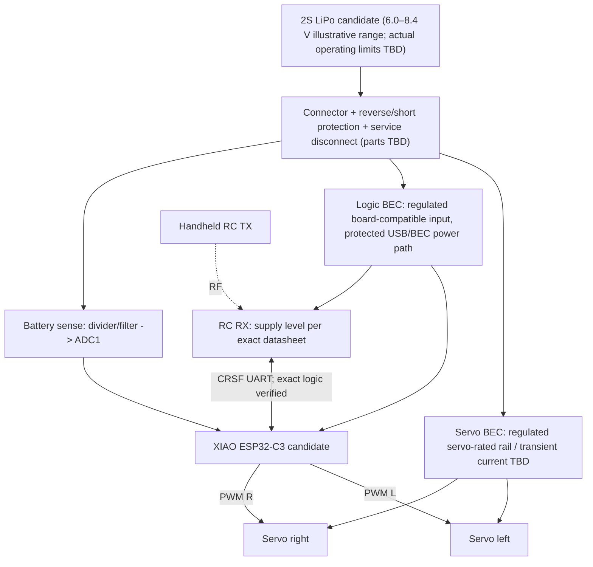

# Bionic Butterfly — Electrical & Power Architecture V1

- **ID:** BB-EE-022 · **Version:** 0.1 · **Date:** 2026-11-12
- **Owner:** Solution Architect · **Status:** PROPOSED / DESIGN REVIEW ONLY
- **Product goal confirmed:** real powered free flight with a physical RC transmitter in **V1**; autonomous flight deferred to **V2**.
- **Inputs:** `03_HARDWARE_DESIGN.md`, `16_RC_INTERFACE_CONTRACT.md`, `19_MECHANICAL_CONCEPT_DESIGN.md`, `20_PRELIMINARY_BOM_MASS_POWER.md`, `21_MECHANICAL_CONCEPT_REVIEW.md`.
- **Important:** This is an **architecture/block diagram**, **NOT a certified wiring schematic**, construction authorization, shopping list or flight authorization. Exact pin levels, component footprints, wire sizes, connector polarity, BEC ratings and electrical protections must be verified from the selected parts' datasheets.

## 1. Scope and boundaries

- **C0:** two independently driven flapping-wing servos, a candidate XIAO ESP32-C3, UART RC receiver, regulated power and battery monitoring. **No decorative LEDs.**
- **C1:** adds independent LED branch and a fresh mass/power/EMI/flight review. It **cannot inherit** C0 approval automatically.
- **V1 flight command owner:** handheld RC transmitter only. Browser/Wi-Fi is setup/diagnostics on the ground, not a flight fallback.
- **Not included:** autopilot, waypoint navigation, automatic position hold, claims of proven lift or stability.

## 2. Proposed topology — power and signal are different networks

**Common signal reference:** Servo/receiver/MCU signal grounds must be electrically common. **Separate servo and logic *supply branches*** do not mean floating grounds. Plan return paths to reduce servo current-induced ground bounce. Prefer short, secured leads and measured noise performance. Receiver antenna routed away from motor/servo leads and without mechanical interference with wing motion. Never apply pack voltage directly to GPIO.

## 3. Supply decision: 2S→buck versus 1S→boost

| Criterion | Candidate A: 2S LiPo + regulated buck (current exploratory baseline) | Candidate B: 1S LiPo + boost / compatible low-voltage actuators |
|---|---|---|
| Electrical | Pack 8.4 V fully charged; **must regulate** to servo/logic ratings | Pack ~4.2 V fully charged; servo/receiver may require regulated boost, unless independently rated for 1S |
| Battery-current implication | Lower input current for equal output power at given efficiency, but 2 cells/charger/BEC add mass | High boost input current can cause sag; 1 cell may save mass |
| Thermal/EMI | Buck efficiency and transients measured | Boost efficiency and transients measured |
| Risk | Feeding 2S to XIAO BAT/5V or non-HV servo = **NO-GO** | Trying to supply 5V servos directly from a 1S pack = **NO-GO** unless actual servo rated appropriately |
| Selection | **PROPOSED only**, pending mass/current tests | Keep as challenger if A misses mass budget |

**Power illustration, NOT measured demand:** If the combined output load briefly reaches 5 V × 2 A = **10 W**, and converter efficiency is only **assumed** 85%, a 2S 7.4 V nominal pack would need roughly `10/(7.4×0.85)=1.59 A`, while a 1S 3.7 V nominal pack would need ~`3.18 A`. During voltage sag, input current rises further; BEC peak response and pack capability must be proven. **This does not establish 2A as the correct BEC rating**: servo stall/transient simultaneous current can exceed it. A 2S 220 mAh pack at 1.59 A would be roughly 7.2C even before peaks; verify *actual pack manufacturer rating*, allowable voltage sag and life.

Do **not** compute endurance simply as nominal Wh / ideal wattage. Measure real load variation, depth-of-discharge reserve, voltage sag and thermal effects. Previously allocated C0 70 g / C1 82 g are **scenario budgets**, not achieved flight weights.

## 4. Power interfaces / prohibited connections

| Net | Proposed function | Absolute rule / verification |
|---|---|---|
| `VBAT_2S` | battery after battery-side protection | 2S pack is **never** connected to XIAO `BAT`, `5V`, `3V3`, MCU GPIO or normal 5V servo pins |
| `V_SERVO` | dedicated regulated supply for left/right servos | Select voltage and max current **only after exact servo datasheet and real coupled-load testing** |
| `V_LOGIC` | independent filtered regulated source for MCU and RX | XIAO input uses **5V pin only through a board-documented safe external-power path**; Seeed documents a diode for external 5V-pin supply; verify USB/BEC backfeed isolation before connecting USB |
| `V_RX` | logic rail or separate RX regulator | Receiver model may require 5V; do not assume all RX boards accept 3.3V supply |
| `GND` | common signal and power reference | physical returns designed to keep servo spikes away from MCU reference; validate with oscilloscope |
| `BAT_SENSE_ADC` | high-resistance divider and filter to MCU ADC1 | compute for *fully charged* 2S and resistor tolerances; ADC never exceeds 3.3V or the selected board's ADC-safe range |
| `PWM_L`, `PWM_R` | ESP32 GPIO-level servo command | GPIO drives **signal only**, not motor current; verify servo 3.3V-high compatibility; boot/reboot behavior measurable |
| `RX_TX`, `RX_RX` | CRSF control and optional telemetry | receiver TX → MCU RX; receiver RX ← MCU TX; verify idle voltage, logic levels, baud/protocol and boot logging conflict |

**Board-specific caution:** Seeed XIAO ESP32-C3 is **1S Li-ion compatible at its BAT pads**, not a 2S charger or 2S power input. Some board documents differ in their quoted 3V3-out current; do not design the receiver/servo supply from that regulator based on a single headline figure. The integrated USB and external regulator must not be connected in parallel without explicit safe power-path verification.

## 5. Battery sense design example (NOT an approved component choice)

- Proposed XIAO pin: **D1 / GPIO3 / ADC1_CH3** (`23_PINOUT_AND_SIGNAL_CONTRACT.md`).
- **Illustrative** divider only: top 47 kΩ, bottom 22 kΩ, each ±1% → at 8.4 V the nominal sense pin voltage is `8.4×22/(47+22)≈2.68 V`. Worst-case resistor tolerance: approx 2.72 V, before transients; still need clamp/filter/ADC accuracy review and board limits.
- Optional RC low-pass capacitor at ADC pin requires analysis of acquisition settling and measurement delay; **no fixed value approved**. Do not use uncalibrated ESP32 ADC reading for a life-critical cutoff. Validate against DMM across battery charge and load.
- Low-battery thresholds and in-flight response remain `TBD`; use pack maker recommendations and **under-load** data. A noisy or disconnected ADC is a fault, not a silent `battery_ok`.

## 6. Servo current, transients and CPU resets

1. Inspect *actual* servo documentation: rated voltage, interface pulse, update rate, holding/operating/stall current, speed, torque, duty cycle, longevity and mass including cables.
2. Test one servo without wing, then two together, then restrained wings. Measure peak and averaged current, rail minimum voltage, MCU reset count and regulator temperature.
3. Never infer required regulator rating from no-load current or a single servo. Fast reversal and a hard stop are credible worst cases; prevent hard stops mechanically and in software, and do not intentionally stall during normal tests.
4. Evaluate local decoupling/bulk capacitance **from measured voltage dips** with suitable voltage and ripple ratings. A capacitor does **not** replace a suitably rated regulator or wiring.
5. Keep watchdog/reset/boot default to DISARMED. A startup glitch can appear before firmware runs; assess via scope with actuators detached and use hardware default-off buffering only if required and compatible with the flight contingency review.
6. LED power for C1 must have its own current budget, anti-flicker/timing and RF-noise verification. LED load shedding may be acceptable; **servo rail loss in flight is not** an approved failsafe.

## 7. In-flight safety versus bench safety

- **Bench G2:** physical current-limited supply/service disconnect, actuator unloaded; on failure stop pulses/disable power using the *bench-approved* response.
- **Restrained G3:** operating in guards, verify all fault transitions, strength/thermal and surge loads; stop on unexpected movement or unstable rail.
- **Flight G4:** do **not** copy bench power-off response into midair operation. Loss of lift may lead to impact. Any in-flight RC timeout / battery contingency must be justified by measured dynamics, test site risk and pilot procedure, and approved by owner after G3. No fixed timeout, cutoff voltage or wing waveform is approved yet.

## 8. Release blockers / decision gates

- **EE-01** Exact MCU, receiver, servo and pack datasheets, operating voltage and pin polarity recorded.
- **EE-02** Battery/USB/BEC sources and backfeed hazard resolved with reviewed schematic.
- **EE-03** Both servos' total peak + rms current, pack sag and logic reset immunity measured.
- **EE-04** Servo PWM 3.3V-level accepted, CRSF UART levels confirmed, boot pin state analyzed.
- **EE-05** Battery divider accuracy and disconnect failure modes measured; telemetered voltage labeled calibrated/uncalibrated.
- **EE-06** Receiver failsafe, reboot, and reconnection bench behavior measured.
- **EE-07** C0 all-up mass and CG updated after true electrical BOM weights.
- **EE-08** Flight-specific loss-of-link / low-voltage strategy approved before G4.

**Current state:** EE-01…EE-08 **NOT RUN / NOT APPROVED**. Do not make a PCB or connect a LiPo to the proposed circuit based on this architecture alone.

## 9. Sources (official)

- Seeed, XIAO ESP32C3 getting started and pin/power map: https://wiki.seeedstudio.com/XIAO_ESP32C3_Getting_Started/
- Espressif, ESP32-C3 technical docs (strapping and GPIO): https://documentation.espressif.com/esp32-c3_datasheet_en.html
- ExpressLRS, receiver UART/CRSF wiring: https://www.expresslrs.org/quick-start/receivers/wiring-up/
- Adafruit, servo power supplies and brownouts: https://learn.adafruit.com/16-channel-pwm-servo-driver/hooking-it-up

## 10. Decision status

- **Locked owner scope:** V1 real RC-powered free flight; V2 autonomy; owner controls GitHub pushes.
- **Still proposed:** 2S power topology, exact XIAO board, pin map, candidate drive and electrical test values.
- **No code task, no hardware assembly, no flight testing authorized by this file.**
