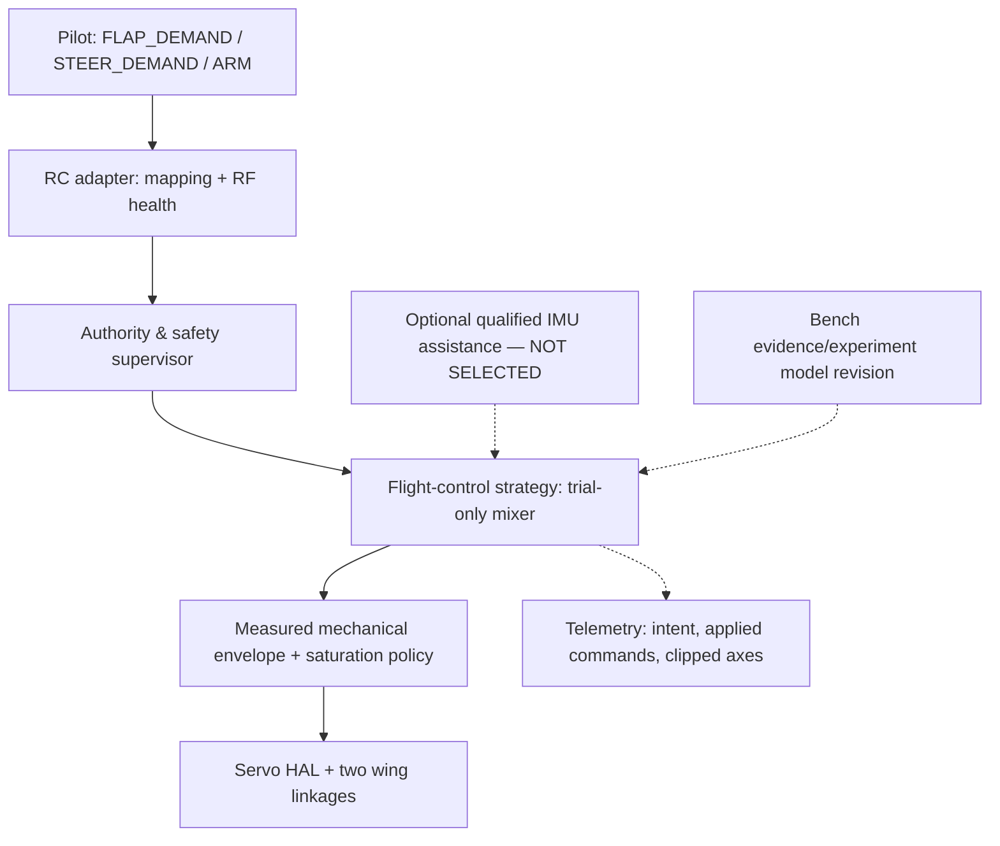

# BionicButterfly — V1 Manual Flight Control Strategy & Mixer Design

- **Document ID:** BB-CTRL-039 | **Revision:** 0.1 | **Date:** 2026-11-12
- **State:** PROPOSED / NOT AIRWORTHINESS-QUALIFIED
- **Goal:** make RC manual flight possible **if** actual aircraft dynamics and hardware support it; V2 navigation/autonomous flight excluded.
- **Related:** `16`, `27`, `28`, `31–38`, `40–41`.

## 1. Separation of concerns

A pilot command is an **intent**, not an assertion of physical yaw, roll, climb or stability. Flight/control code must never bypass the safety supervisor or write directly to servo outputs from RC/GUI callbacks. The `FLIGHT` context does not automatically imply real in-air state or position sensing.

## 2. Candidate open-loop human pilot strategy (M1)

Let `t in [0,1]` be calibrated flap demand; `s in [-1,1]` be calibrated steering demand; `a(t)` be approved common drive mapping; `d(t,s)` an experimentally calibrated differential request. Candidate:

\[
 u_c=a(t),\qquad u_d=d(t,s),\qquad u_L=u_c-u_d,\quad u_R=u_c+u_d.
\]

The mixer must preserve these conceptual invariants:

- `s=0 => u_d=0` except explicitly recorded left/right trim compensation.
- At zero permitted flap demand, steering command alone must not unexpectedly energize a wing; physical stop/hold policy **differs by context** and remains G4-open.
- Within all experimental profiles, mechanical stroke, duty, servo travel, power/current and per-cycle motion rates remain inside qualified limits. **No universal limits have been measured**.
- Under saturation, report requested and *applied* `u_c,u_d`. A naive per-wing clamp distorts differential authority and may reverse steering; choose priority based on **measured force reserve and stability**, not aesthetics.
- A full stick reversal cannot directly flip actuator direction outside the measured mechanical/thermal envelope; define bounded smooth transitions and qualify dynamics on G3.
- Left/right steering sign (`s`→`u_d`→observed moment/path) remains **UNVERIFIED**, and must be calibrated from measurement. Do not confuse transmitter servo reverse with verified turn direction.

### 2.1 Pilot experience contract

The throttle stick requests **more or less flap activity**, not direct altitude or velocity. Steering stick requests **a direction-change bias**, not a guaranteed heading rate. The radio's UI and simulator should display actual status labels: `FLAP_REQUEST`, `DIFF_REQUEST`, `RF_HEALTH`, `ACTUATION_STATE`, `MEASURED/UNKNOWN AERO MOMENT`, `PROFILE_REV`, `LIMITED_OUTPUT` (when clamped). Never label controller as `ALTITUDE_HOLD`, `YAW_HOLD`, `AUTOPILOT` in V1 without new approved capability and data.

## 3. Strategy candidates and escalation triggers

| Strategy | How it works | When to evaluate | Pros / limitations | Approval |
|---|---|---|---|---|
| **S0: Manual open-loop differential** | pilot commands common/differential wing drive | initial G1/G3; not automatically G4 | few components; may be hard/impossible to recover pitch/roll | PROPOSED to evaluate |
| **S1: Passive stabilization** | trim, CG, wing geometry, tail/dihedral if feasible | if bench moment map exists but attitude is unstable | no active sensors; changes airframe and moments | OPEN mechanical ADR |
| **S2: Manual RC with lightweight IMU damping** | pilot retains trajectory/control authority; IMU regulates limited rates/attitude within approved envelope | if S0/S1 cannot deliver recoverable control and mass allows | extra sensor/software burden; **not V2 autonomy** by itself | OWNER APPROVAL REQUIRED |
| **S3: Extra attitude actuator / changed linkage** | add independently actuated tail, wing twist or stroke-plane degree of freedom | if yaw/pitch/roll authority absent or hopelessly coupled | weight/power tradeoff, possible new transmission | OWNER APPROVAL REQUIRED |
| **S4: Alternative propulsion/flapper** | redesign if thrust/mass/efficiency feasibility fails | if G3 force margin or mechanism durability cannot support goal | resets prior hardware design | OWNER APPROVAL REQUIRED |

Evidence example: COLIBRI actively controls pitch/roll using wing-root mechanism but yaw is passively stable for its specific machine ([COLIBRI](https://journals.sagepub.com/doi/full/10.1177/1756829317695563)). A 2025 prototype achieved roll/pitch hover feedback but not yaw ([2025 study](https://pmc.ncbi.nlm.nih.gov/articles/PMC12563709/)). These are **design references, not transferable servo gains**.

## 4. Why an IMU does not automatically mean 'self-flying'

**Manual RC V1:** a human commands takeoff intensity and direction. A permitted stabilization layer may damp disturbances and correct unintended attitude errors but cannot select goals/routes, GPS waypoints or independently navigate. **Autonomous V2:** aircraft plans navigation or motion without continuous human intent. Any proposed S2 must define which attitude states are actually observable, the controlled axes, sensor quality near flapping vibration, intervention bounds, log visibility and manual override. No S2 is currently approved or implemented.

## 5. Control-effectiveness and authority conflicts

With two input coordinates and several desired outputs, *high* steer bias may compromise net vertical force, or correct roll while worsening yaw/pitch. Define an explicit **priority schedule** only after data:

| Pilot/system objective | G1 theoretical behavior | G3 evidence required | G4 status |
|---|---|---|---|
| Increase flap demand | increase common requested stroke | measured wing motion, mean body forces, current | NOT QUALIFIED |
| Steer left/right | apply signed differential | measured moment(s) and steering sign vs operating point | NOT QUALIFIED |
| Keep stable attitude | unspecified under S0 | passive restoring or bounded sensor-feedback response | OPEN |
| Recover link loss / midair disarm | cannot be inferred from simple mixer | distinct flight-hazard analysis and safe-exit concept | BLOCKER |

In G1, test mathematically controlled clipping, slew and fault handling **without claiming flight dynamics**. G3 measures responses on the real restrained airframe. G4 requires separate actual manual-control observation and authorization.

## 6. Design of experiments for a control revision

1. Freeze airframe build/CG/servo/profile and validated G2 electrical envelope.
2. Measure G3 local `B(uc,ud)` and sign at multiple operating conditions (`38`); quantify steering–lift cross-coupling and uncertainty.
3. Record whether attitude stability can be plausibly passively supplied; do not manufacture a yaw channel from mixer signs.
4. Propose S0, S1, S2, S3 or S4 in a new ADR with *measured* evidence and mass/power effect.
5. After owner approves a bounded design slice, G1 simulation/bench code tasks may be assigned; the **flight phase** still requires separate G4 approval.
6. Pilot mapping/channel versions in `32–33` must be updated along with any control revisions, not changed live during an armed run.

## 7. Explicit disallowed assumptions

- 'Two servos means controllable pitch and yaw' — **false as a generic claim**.
- 'Net thrust from scale greater than weight means stable flight' — **not established**.
- 'Servo frequency in firmware equals actual wing frequency' — **not established**.
- 'Disarm while airborne safely powers off wings' — **not established**.
- 'Simulator physics validates free flight without measured coefficients' — **false**.
- 'RC only means no stabilizer can ever be considered' — **not an owner decision**; any addition requires explicit scope approval.

**Current recommendation:** keep **S0 as a candidate for bench identification**, but do not lock it as a flight-ready controller or choose IMU/control gains until data exist.
