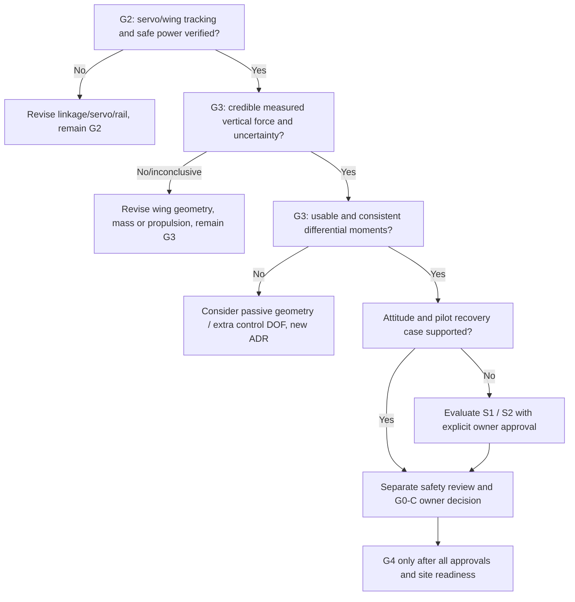

# BionicButterfly — Flight-Control Concept Trade Study & Decision Log

- **Document ID:** BB-ADR-041 | **Revision:** 0.1 | **Date:** 2026-11-12
- **Status:** PROPOSED; owner decision pending. **None of the variants below is approved for flight.**
- **Related:** `15`, `19–21`, `27`, `31`, `37–40`.

## 1. The decision we are NOT ready to make

Is *two servo, tailless, manual open-loop* sufficient for the user's V1: purposeful RC-controlled free flight, with acceptable takeoff/turning/recovery? **Answer: UNKNOWN.** The user approved the *product outcome*, not a specific number/type of servos or stabilization method. A successful desk-demo or simulated wing motion cannot close this decision.

## 2. Concept comparison — qualitative only

Score interpretation: `+` likely simpler for that dimension, `−` more trade-off, `?` unknown on our airframe. **These are hypotheses**, not measured weighted scores.

| Concept | Core mechanism | Potential benefit | Dominant risk | Mass/power consequence | Current action |
|---|---|---|---|---|---|
| **A M1 + S0** | 2 servos, manual common/differential | simplest firmware, preserves bionic appearance | insufficient pitch/yaw authority and disturbance recovery | baseline budget C0 | instrument G2/G3 first |
| **B M1 + passive S1** | 2 servos + CG/dihedral/wing geometry/tail tuning | may stabilize modes without electronics | passive changes may reduce maneuverability or add drag | extra structure or shifted mass | evaluate only after measured instability |
| **C M1 + IMU S2** | 2 servos + measured attitude-rate damping under pilot authority | could assist recovery in some modes | actuator authority and IMU vibration may defeat feedback | sensor, computation, validation weight | owner decision required |
| **D M1 + added actuator S3** | add tail/wing-root twist/stroke-plane degree of freedom | additional independent control possibility | mechanical complexity, mass/inertia, assembly tolerance | higher power/mass | open redesign option |
| **E M2 alternative actuation S4** | e.g. motor-crank transmission | may reach different stroke-speed/efficiency | difficult differential steering/controllability | fresh motor, gearbox, power, driver BOM | only after measured M1 limits |

Do not treat an IMU sensor as a guaranteed stability solution. Sensors reveal only measured states; actuators must still generate correcting moments. User may approve S2 while keeping V1 **human-piloted** and reserving autonomous navigation for V2.

## 3. Trade study criteria to collect (no invented purchase prices)

| Criterion | Evidence needed | Why it changes selection |
|---|---|---|
| Specific force vs mass | measured `F_B`, actual mass/CG (C0/C1) | climb/trim possibility |
| Actual servo stroke response | phase/amplitude/current over G2 range | a nominal speed spec is not wing stroke proof |
| Steering moment | derivative `dMx,dMy,dMz` vs `u_d` with uncertainty | is pilot turn request effective and predictable? |
| Stability & recovery | passive mode evidence or demonstrably bounded feedback ability | separate 'can lift' from 'can be flown' |
| Control interference | how differential affects mean vertical force and body pitch | saturation may remove flight margin |
| LED payload effect | actual LED wing distribution, inertia and power | C1 needs independent qualification |
| Safety & reproducibility | RF loss, disarm, under-voltage, mechanical fatigue | must be addressed before flight |
| Build/maintenance cost | final part prices and test/replacement burden | avoid unreliable single-use demos |

## 4. Decision branching (G3 then G0-C, not today)

**Important correction:** the branch `H -> I` means *re-evaluate after S1/S2 evidence*, not automatic approval; insufficient or inconclusive results return to G3. A force reading above weight is **not** the only input to the branching decision.

## 5. New decision IDs for `15_V1_DECISION_REGISTER.md`

| ID | Proposed decision | Approval state | Unlock condition |
|---|---|---|---|
| **D-037** | maintain model maturity D0–D3; no predictive free-flight claims from kinematics-only simulator | PROPOSED | owner approves model labeling/limits |
| **D-038** | use measured force/moment control-effectiveness map with stated uncertainty before flight mixer sign/authority is frozen | PROPOSED | G3 sensor capability and repeatable data |
| **D-039** | S0 manual differential as first testable concept, **not selected flight controller** | PROPOSED | G2/G3 outcomes and owner review |
| **D-040** | IMU stabilization is optional V1 assistance only after separate decision, never automatically V2 autonomy | PROPOSED | proven observability, authority, mass and owner approval |
| **D-041** | if two-control concept cannot meet authority/stability, revise mechanics, consider passive/extra actuator instead of forcing software 'fix' | PROPOSED | failed/inconclusive CA evidence, alternatives reviewed |
| **D-042** | G4 eligibility requires measured controllability and airframe-specific recovery safety, beyond lift proxy | PROPOSED | FA-01…12/owner test approval |
| **D-043** | C1 LED is a fresh aero-inertial qualification, not just C0 + added grams | PROPOSED | C0 validated + C1 mass/power/inertia tests |

All D-037–043 are intentionally still `PROPOSED`. The owner can explicitly accept/reject a bounded scope later. No tasks are created in `Task/` and no repository changes are implied.

## 6. Future review package before deciding hardware freeze

Evidence package `FLIGHT-AUTHORITY-REV-<id>` should include: drawing and physical revision, true all-up mass, CG, reference/sensor axes, approved G2 logs, G3 force/moment time histories, repeatability/uncertainty table, RC model/version/map, calibrated steering sign, flight-safety hazard list, subsystem failure modes, revised BOM and time/cost implications. SA files an ADR review against this package; owner accepts a specific revision. No silent adoption of prior papers' sensor gains, masses, forces or wing profiles.

## 7. External scientific background (for engineering judgement only)

- USTButterfly servo-based design (IEEE TIE, 2023/2024): https://doi.org/10.1109/TIE.2023.3260355
- COLIBRI active roll/pitch, passive yaw (2017): https://journals.sagepub.com/doi/full/10.1177/1756829317695563
- Roll/pitch controlled hover, yaw not achieved, 2025: https://pmc.ncbi.nlm.nih.gov/articles/PMC12563709/
- Stroke plane / wing trailing-edge mechanics needed for moment axis generation (2016): https://www.sciencedirect.com/science/article/pii/S1672652916603189
- Butterfly external-camera tracking is not same as stand-alone RC control: https://www.festo.com/us/en/e/about-festo/research-and-development/bionic-learning-network/bionic-flying-objects/emotionbutterflies-id_33454
- 2026 experimental yaw improvement is *another* airframe/control design, not proof for ours: https://doi.org/10.1016/j.conengprac.2026.106929
