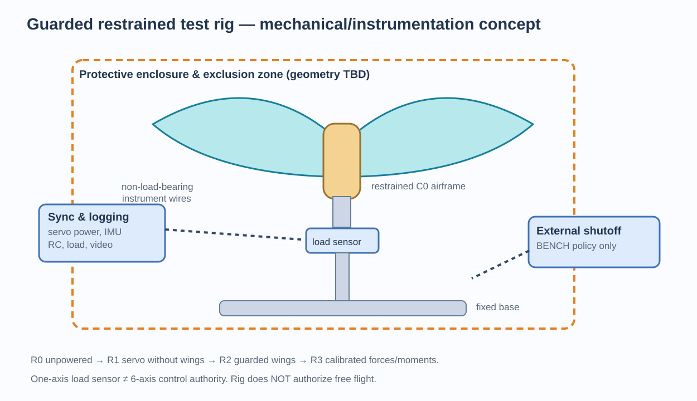

# BionicButterfly — Restrained Mechanical Test Rig & Measurement Architecture

- **ID:** BB-RIG-046 | **Rev:** 0.1 | **Owner:** SA | **Status:** PROPOSED / NO HARDWARE TEST AUTHORIZED
- **Purpose:** safely distinguish commanded wing motion, actual wing motion, reaction force/moment, electrical load and structural response without claiming demonstrated free flight.
- **Related:** `18_MECHANICAL_EXPERIMENT_PLAN.md`, `24_ELECTRICAL_BENCH_VERIFICATION.md`, `38_CONTROL_AUTHORITY_IDENTIFICATION_PLAN.md`, `40_FLIGHT_VALIDATION_AND_EVIDENCE_STANDARD.md`.

## 1. Distinguish fixture configurations

| Rig stage | Physical state | Measurement | Forbidden inference |
|---|---|---|---|
| **R0 geometric dummy** | unplugged / no power, dummy battery if needed | clearance, swept envelope, CG, fit | servo tracking or aerodynamic lift |
| **R1 free-servo stand** | servo(s) attached to controlled power, **no wings** | PWM mapping, startup transients, current, thermal, limit | loaded-stroke performance |
| **R2 fully guarded winged fixture** | complete C0 structure fixed with positive retention | wing angles and frequency, current/sag, structural vibration | free-flight stability |
| **R3 calibrated load measurement** | R2 plus force/moment sensor and calibration | force/moment response at specific operating points with uncertainty | all-axis control authority from one force axis; autonomous flight |

When sensors or fixture geometry differ, log a new `rig_revision`, rerun baseline and recalibrate.

## 2. Architecture



Mechanical requirements: rigid non-tipping mounting base, positive airframe retention, guarding/perimeter outside complete swept volume **plus measured deflection and possible fragments**, visually accessible power disconnect outside wing reach, and documented fixture resonance. Do not hang the aircraft from a single exposed flexible wire or presume foam tape is a secure restraining mount. Rig clearance and barriers are designed for potential wing/spar ejection, not just normal strokes.

No person shall use this draft as a go-ahead to power the rig. It requires the electrical review (`22–25`), component datasheets, guard design and signed test plan.

## 3. Measurement chain / sensor selection is use-case-specific

| Channel | Instrument candidate | Necessary fidelity / limitations |
|---|---|---|
| `wing_phi_L/R` and `f_actual` | timestamped high-frame-rate video with markers or measured angle encoder | enough time resolution to observe phase; avoid aliasing; both sides synchronous |
| `V_bat`, `V_servo`, `V_logic` | isolated/safe voltage logger and scope when appropriate | identify servo pulse sag and MCU resets; accurate grounding |
| `I_servo_L/R`, supply current | shunt/current probe sized for safe pulse load | capture peaks and average across multiple cycles, not just DMM idle reading |
| `F_B`, `M_B` | calibrated multi-axis load cell or custom fixture with independently validated axes | **one-axis load cell cannot recover yaw/pitch/roll moments** |
| `body vibration` | accelerometer on fixture + camera tracking | separate airframe motion from rig resonance / sensor signal |
| `temp` | external non-contact/contact sensor as permitted by vendor | no universal temperature cutoff without datasheet |
| `RC link/MCU state` | logged timestamped valid frame, RF health evidence, arm state | doesn't substitute for physical measurements |

If only a one-axis scale/load sensor is affordable, approve **R3-FORCE-ONLY** with strictly narrower claims; do not fill unmeasured matrix `B` moments with zeros.

## 4. Calibration and data acquisition contract

- Define one body frame `B` per `42`: `+X` forward, `+Y` right, `+Z` down. Sensor native frame `S` requires measured orientation transform, force direction calibration and lever-arm correction to the CG reference.
- Before each series: record tare with fixture/airframe, standard known-force sign/scale checks, pre/post zero drift, sensor serial and last calibration date.
- For dynamic waveforms sample sufficiently fast to resolve significant harmonics; a **provisional acquisition-study target of at least ~20 samples per flap cycle** is for planning only, not a proven sufficient bandwidth. Assess 5–10× higher sampling or high-speed video where aliasing/rapid reversals warrant it, using actual sensor anti-alias filters/resonance data.
- Synchronize firmware commands, telemetry, load sensor and video using a deliberately recorded synchronization event; log clock offsets, jitter and uncertainty. If synchronization is weak, label phase estimates INVALID.
- Evaluate noise and resonances using zero-power, no-wing (where mechanically safe), with-wing stationary, and run cases; removing the wing changes inertia, so naive subtraction is not guaranteed to isolate aerodynamic force.
- Store raw sensor signals and processed time histories; record processing filter versions and **time windows (full cycles)** used for means and confidence bounds. A single peak load is not lift evidence.
- Sensor moments about the fixture origin must be shifted to the CG using measured geometry: `M_CG = M_O - r_(O->CG) × F` in common coordinates. Angular acceleration from wing reaction may also contaminate measured fixture load.

## 5. Test design and metrology plan

| ID | Context | Measured outcome | Constraint |
|---|---|---|---|
| `RG-01` | R0 | overall wing-sweep guard and wiring clearance | manual unpowered check before any R1/R2 |
| `RG-02` | R1 | startup signal, wrong-side inversion, servo pulse envelope | electrical gate approved and no attached wings |
| `RG-03` | R2 | L/R waveform at three bounded demand levels | part data/temperature and hard-stop observed |
| `RG-04` | R2 | backlash and L/R phase drift across defined cycles | stop at wear or unexpected vibration |
| `RG-05` | R3 | force-axis sign and zero stability; test uncertainty | no data claim without calibration |
| `RG-06` | R3 | common demand changes; force/moment response | sufficient axis instrumentation for each reported term |
| `RG-07` | R3 | differential demand ±s; moment sign/repeatability | never infer yaw if yaw torque unmeasured |
| `RG-08` | R3 | force/moment vs battery voltage/servo temperature/wing revision | separately identify operating envelope changes |
| `RG-09` | R2/R3 | link-loss, power anomaly and bench-specific stop logic | not an in-air failsafe simulation without identified flight model |
| `RG-10` | R3 | response to W-A vs W-B or direct drive vs linkage | rig and sensor calibration unchanged or recharacterized |

All `RG-*` are currently **NOT RUN**. There are no force, yaw moment or servo-tracking measurements for the proposed airframe yet.

## 6. Stop / hold / go principles

**Immediate hold** for uncontained moving wing, fixture motion/lift-off, cracked carbon spar, detached membrane, runaway output, unexpected power draw/rail collapse, servo stall/overheating, RF authority confusion, or failed sensor calibration. Thresholds tied to datasheets and rig rating must be set in a signed test procedure before any powered test.

No result at R3 authorizes G4 flight. G4 needs an independent flight-specific safety and pilot review, resolved in-air loss-of-link/disarm handling, qualified stability/control authority and venue permissions.

## 7. Suggested evidence manifest

```yaml
trial_id: RG-__
status: NOT_RUN
config: C0
wing_rev: null
mech_rev: null
firmware_commit: null
power_config: null
rig_revision: null
sensor_calibration_ids: []
frame_contract: B_x_forward_y_right_z_down
conditions: {flap_cmd: null, steer_cmd: null, voltage: null}
observed: {f_actual: null, F_B: null, M_B: null, current_peak: null, temp: null}
uncertainty: {}
raw_data_links: []
operator: null
reviewer: null
claim_level: UNKNOWN
```

Literature context: [FWMAV fabrication review](https://pmc.ncbi.nlm.nih.gov/articles/PMC6412266/), [mechanical review](https://link.springer.com/article/10.1007/s42235-021-00118-4).
