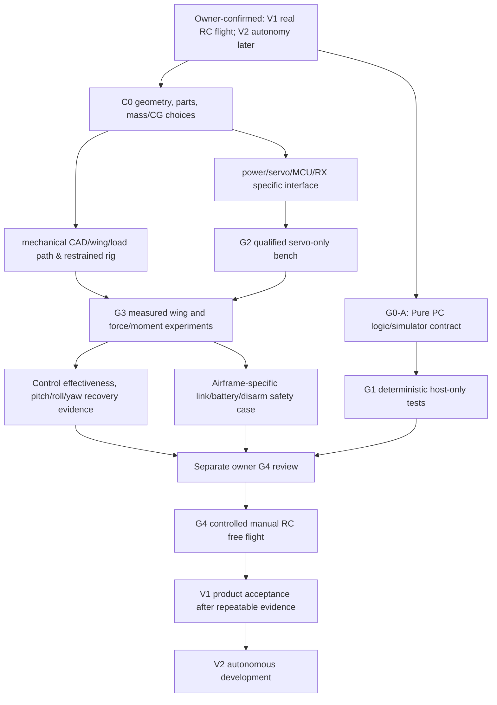

# BionicButterfly — Architecture Decision Dependency Map (Design-only)

- **Document ID:** BB-DEP-050 · **Revision:** 0.1 · **Date:** 2026-11-12
- **Status:** PROPOSED. Complements `15_V1_DECISION_REGISTER.md`; does not approve any ADR.

## 1. Dependency graph

**Not a schedule:** G1 can be planned/approved independently of hardware measurements; G4 cannot be authorized merely because G1 passed. Links in the graph express evidence dependencies, not automatic approval.

## 2. Proposed freeze slices

| Slice | Purpose | Inputs required to approve scope | Still excluded |
|---|---|---|---|
| **G0-A1 (PC contracts)** | `SafetySupervisor`, validated receiver *observation types*, ownership, virtual time, event model | latest `02`,`16`,`27`,`28`,`29`,`30`; CF-04,08,10,11,13,17 resolved | firmware flash, real motors, Wi-Fi airborne, physical failsafe policy |
| **G0-A2 (PC simulator UX)** | simulator, scenario replay, profile isolation and read-only status view | A1-approved schema + `05`,`32–36`,`51`,`52` | modelled ‘stable flight’, force/airworthiness claims |
| **G0-B1 (electrical bench design)** | exact board/receiver/servo power, no-wing signal generation | exact component BOM, `22–25`, CF-06/07/14 and authorized EE tests | restrained wings, flying |
| **G0-B2 (mechanics and guarded rig)** | measured servo/wing response, forces/moments | released CAD, rig hazard and sensor calibration plan, G2 evidence, `42–47` | G4 uncontrolled free flight |
| **G0-C (flight case)** | intentional RC-controlled free flight | G1–G3 evidence, numeric acceptance, pilot/site/radio risk, flight contingency and separate owner go/no-go | V2 navigation/autonomy |

**All slice approvals currently PENDING.** There is no need to block *design* of A1 on final servo and battery choices; A1 must remain pure and explicitly non-airworthy.

## 3. Open architectural choices (input, owner, consequence)

| Choice | Proposed owner | Dependency / where it affects | Disposition |
|---|---|---|---|
| A1 approved virtual behavior & typed contracts | Project owner after SA review | `51`, `27/28`, `52` | PENDING |
| exact TX/RX and firmware/switch modes | Owner + future tester | `16`, `23`, `32`, CF-05/14 | PENDING |
| servo and transmission A/B | Owner after rig studies | `20–25`, `42–47`, force map | PENDING |
| wing variants W-A/W-B, actual mass/CG | Owner after engineering review | `37–41`, `44`, G3 | PENDING |
| 1S vs 2S power architecture, protection & wiring | Owner + qualified electrical review | `22–25`, CF-07, G2 | PENDING |
| flight assistance IMU permitted for manual V1? | Owner with control study | `39`, `41`, UI, new requirements if selected | OPEN |
| what happens upon loss of RF/power **in air** | Owner following evidence/flight safety review | `25`, `27`, `40`, G4 | **BLOCKER** |
| safe site, pilot, flight acceptance numbers | Owner after G3 | `40`, flight plan | **BLOCKER** |
| third-party licenses and file origin | SA with owner approval | `01`, `12`, legal provenance | PENDING |

## 4. Phrasing for explicit future approval

A valid design approval must state exact **slice**, artifact list/revisions, exceptions, status of unresolved hazards and permitted next action. For example: `APPROVE G0-A1 CONTRACTS ONLY, no powered hardware, no physical failsafe, no Task yet until SA handoff proposal accepted`. This text is an illustrative **approval format**, *not an approval provided by the user*. 

If the owner wishes to remain in design-only mode, record `CONTINUE DESIGN` instead; do not open a coding task on that basis.
