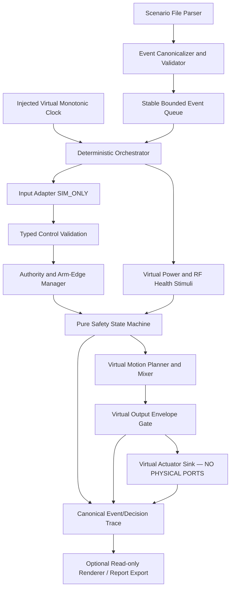

# BionicButterfly — Phase 2.1 / G0-A1 Host Software Architecture

- **ID:** BB-G0A-SW-056 · **Revision:** 0.1 · **Date:** 2026-11-12
- **Authority:** Solution Architect (SA) · **Status:** PROPOSED / NOT APPROVED / DESIGN ONLY
- **Scope:** PC host simulator contract, **no physical actuator access**. V1 target remains a **real RC-piloted butterfly**; V2 autonomy deferred. Host simulator is an engineering prerequisite, not the finished V1.
- **References:** `02`, `05`, `07`, `10`, `11`, `14–16`, `27–30`, `32–36`, `37–41`, `48–55`. Latest owner Git `Design/` files were *reported pushed* but **could not be independently fetched** while authoring Phase 2.1. This package is additive; conflicts must be reconciled at exact commit before freeze.

## 1. Architectural goals, non-goals and trust boundary

### Goals for an eventual bounded G0-A1 approval

1. Define a deterministic, testable, **pure host core** with validated input, explicit authorization, central safety state machine, bounded virtual wing command and structured trace.
2. Guarantee *by construction* that a PC simulator binary cannot load a physical PWM/UART/RC transmitter/servo driver nor obtain flight authorization merely by changing config or an environment variable.
3. Ensure fixed-input + fixed-config + fixed virtual-clock replay produces the same **canonical logical output**. Any float tolerance or trace hashing must be explicitly defined.
4. Let safety reviewers audit rules without reverse-engineering UI, interrupt handlers or device firmware.
5. Support future separate G0-B hardware adapters without importing hardware dependencies into the pure core; hardware integration requires a fresh architectural review and new permission.

### Hard exclusions

- No ESP32 firmware implementation, PlatformIO board build, actual GPIO/UART, servo pulses, ESC, LiPo measurements, RF transmit, live motor/wings, physical flight, internet-based piloting, autopilot/position-hold, claimed aerodynamic 6DOF fidelity or in-air failsafe policy.
- No copied reference C++/STL/CAD without per-file license review; previous upstream reference audit found unresolved provenance.
- No `Source/` changes or `Task/` file from this design deliverable; owner approval is required first.

## 2. Logical components and dependency direction

**Allowed dependencies:** `Scenario/CLI/UI` → `application orchestrator` → `domain core` → interface types. The core has **zero dependencies** on `UI`, ESP-IDF, Arduino, Wi-Fi libraries, real timers, environment variables or filesystem. Trace exporters/viewers consume immutable value objects and cannot call the actuator sink in reverse.

| Component / port | Owns | Must never do |
|---|---|---|
| `ScenarioParser` | parse finite sized scenario, schema and provenance | grant ARM, accept physical context |
| `EventCanonicalizer` | timestamp/range/id validation, stable ordering, reject duplicate ambiguous intents | silently coerce bad data into valid pilot controls |
| `VirtualClock` | deterministic `now_us`, no wall-clock sleeps | wrap/restart in live run without explicit reset event |
| `InputAdapterSim` | injected pilot/RF/receiver values *tagged SIM_ONLY* | claim values were received over real RF |
| `InputValidator` | range, finiteness, map profile, source validity, freshness | refresh valid pilot time from rejected/telemetry-only frames |
| `AuthorityManager` | single source, arm edge, revocation | allow UI takeover or physical RC under host build |
| `SafetySupervisor` | state, fault priority, explicit host contingency and recovery | infer actual airborne state, set PWM |
| `VirtualMotionPlanner` | waveform phase / request-level common and differential commands | claim lift, yaw, measured flap angle |
| `EnvelopeGate` | finite and bounded normalized L/R **virtual** command | use unmeasured physical servo pulse defaults |
| `VirtualActuatorSink` | record commands, replay only | import hardware I/O adapters |
| `TraceSink` | stable structured events, denied reasons, provenance | mutate supervisor state or reorder events |

## 3. Composition and isolation guarantees

- **Host build composition root** constructs `VirtualActuatorSink`, `InputAdapterSim`, `VirtualClock` and **only** `OperationContext.PC_SIM`.
- No runtime `--hardware`, secret config field, browser request or profile string can install a physical driver. A future board build shall be a separately reviewed composition with new adapters, safety case and hardware gate.
- Inputs from scenario files are *untrusted test stimuli* and always labeled `INJECTED`/`SIM_ONLY` even if a property says `rf_health=HEALTHY`.
- The optional UI shows **SIMULATED** in every view; physical measurements, airborne state and actuator feedback are `UNKNOWN` or `null` unless a physically qualified sensor interface exists (out of scope).
- An invalid scenario or missing safety policy fails with a typed error and `motion_enabled=false`. There is **no** default real-flight mode.
- Domain calculations use explicit units and local injected time; the *virtual servo carrier period* is separate from mechanical flap frequency and from core evaluation period.

## 4. Integration interfaces to design in this phase

| Contract | Canonical owner | Further design |
|---|---|---|
| `ScenarioV1` and `EventV1` | `57` | version, event id, monotonic time, payload types, bounds, provenance |
| `SimObservationV1` | `57` | validated source, simulated RF flag independent from frame freshness |
| `SafetyState`, `DecisionV1` | `58` | full transition/priority/clock semantics, no auto-arm |
| `SchedulerV1` | `59` | stable event grouping, deterministic replay, budgets, trace equality |
| `SimConfigV1` / `ProfileV1` | `60` | disarmed-only update and scope-tagged numeric placeholders |
| `Core Step API` | `61` | input/output tuples, failure/return semantics; no networking dependency |
| security and abuse constraints | `62` | malicious scenarios/UI, resource limits and artifact provenance |
| tests and freeze acceptance | `63` / `64` | cross-reference PC-A01–20 from `52`, no invented PASS |

## 5. Architectural decisions still open (Phase 2.1 proposal)

- **D-051** Pure PC build physically cannot link hardware drivers or grant FLIGHT context.
- **D-052** Canonical input/decision/trace schema is versioned, typed, immutable and includes data provenance.
- **D-053** Same-timestamp events form an atomic batch; deterministic priority and rejection of ambiguous conflicting commands.
- **D-054** Simulator-specific ground/contingency behavior cannot serve as a physical in-air failsafe implementation.
- **D-055** Configuration is `SIM_ONLY` and cannot be changed while virtual state is armed; no fallback to flight defaults.
- **D-056** Deterministic virtual-time scheduler, stable hash and bounded resources.
- **D-057** Browser is a reader/scenario author; it has no direct PWM/actuation interface.
- **D-058** G0-A1 design freeze needs the exact owner Git baseline, conflict disposition and explicit approval.

Every D-051–058 is **PROPOSED**, not implied approved by a request to continue.

## 6. What a design freeze does and does not mean

G0-A1 can be approved as an **interface and verification baseline** once exact repository revisions and P0 contradictions have been reconciled and the owner accepts the bounded scope. Only a later, separate, explicit instruction would authorize creating a `Task/` file for an AI Developer. **G0-A1 approval never approves G2/G3 hardware power-on or G4 flight.**
