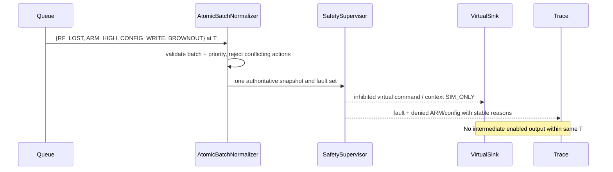

# BionicButterfly — Phase 2.1 Core Ports, APIs & Interaction Sequences

> **Phase 2.4 review note (2026-11-12):** See the candidate corrective addendum at the end and `84–90` before treating older priority/approval text as normative. **Pending owner approval; not code or flight authorization.**

- **ID:** BB-G0A-API-061 · **Rev:** 0.2 · **Date:** 2026-11-12
- **Status:** PROPOSED / API SPECIFICATION, NO IMPLEMENTATION
- **Scope:** host-only pure core plus scenario runner. No HTTP/Cloud Browser/ESP32 requirements are implied.

## 1. Proposed language-neutral port shapes

```text
interface VirtualClock { now_us() -> uint64 }
interface InputQueue {
  peek_time_us() -> uint64?;
  take_at_or_before(eval_at_us: uint64) -> list<SimEventV1>;
}
interface CoreSafety {
  evaluate(snapshot: SafetySnapshotV1, batch: CanonicalBatchV1,
           policy: SimPolicyV1, now_us: uint64)
     -> (SafetySnapshotV1, SafetyDecisionV1);
}
interface VirtualPlanner {
  plan(decision: SafetyDecisionV1, accepted_intent?: ControlIntentV1,
       phase_state: VirtualPhaseStateV1, now_us: uint64,
       policy: SimPolicyV1)
     -> (VirtualPhaseStateV1, VirtualWingCommandV1);
}
interface VirtualEnvelope {
  limit(command: VirtualWingCommandV1, policy: SimPolicyV1)
     -> BoundedVirtualWingCommandV1;
}
interface VirtualActuatorSink {
  record(command: BoundedVirtualWingCommandV1); // NO PHYSICAL OUTPUT
}
interface TraceSink { append(event: TraceEventV1) -> Result<StoredTraceRef,TraceError> }
interface HostRunner {
  validate(scenario, policy) -> ValidationReport;
  run(scenario, policy, seed?) -> SimulationRunReport;
}
```

**Design ownership:** all core contracts accept/return immutable typed values. No core callback writes to actuator or UI directly; the orchestrator is the only stage that can call a virtual sink after a successful envelope decision. Interfaces and names may change at a separately approved freeze; this text is not source code.

## 2. End-to-end: valid simulated arm and flap request

```mermaid
sequenceDiagram
    participant Scenario
    participant Queue
    participant Input as InputValidator
    participant Auth as AuthorityManager
    participant FSM as SafetySupervisor
    participant Plan as MotionPlanner
    participant Gate as EnvelopeGate
    participant Sink as VirtualSink
    participant Trace
    Scenario->>Queue: BOOT, RF HEALTHY_SIM, valid LOW frame
    Queue->>Input: atomic batch at T1
    Input->>Auth: validated low + fresh simulated RF
    Auth->>FSM: observe safe disarm precondition
    FSM-->>Trace: DISARMED with no motion
    Scenario->>Queue: distinct HIGH frame at T2
    Queue->>Input: validate T2 frame
    Input->>Auth: possible arm edge
    Auth->>FSM: ARM_CHECK with guard snapshot
    FSM-->>Trace: ARM_CHECK (no virtual flap)
    Scenario->>Queue: qualifying healthy frames; later flap demand
    Queue->>FSM: qualification events
    FSM-->>Trace: ARMED_IDLE only if guard passed
    FSM->>Plan: qualified subsequent flap intent
    Plan->>Gate: requested normalized wing L/R
    Gate->>Sink: bounded SIM_ONLY values
    Sink-->>Trace: trace virtual motion; physical lift UNKNOWN
```

The diagram is an **allowed sequence** only when configured qualification criteria are met. It is not an assertion that `T2` or a fixed number of ticks always arms.

## 3. Race: RF loss, ARM, web request and brownout at same virtual time



## 4. Fault recovery and no automatic restart

```mermaid
sequenceDiagram
    participant Sim as Scenario
    participant FSM as SafetySupervisor
    participant Trace
    Sim->>FSM: RF_LOST while ACTUATION_ACTIVE
    FSM-->>Trace: CONTINGENCY, SIM_ONLY output inhibited
    Sim->>FSM: RF_HEALTHY again, ARM remains HIGH
    FSM-->>Trace: stay in CONTINGENCY; deny implicit rearm
    Sim->>FSM: deliberate safe reset/ack with ARM LOW
    FSM-->>Trace: DISARMED if all recovery guards pass
    Sim->>FSM: new valid LOW then HIGH under healthy frame/guards
    FSM-->>Trace: ARM_CHECK, then later ARMED_IDLE if qualified
```

Never translate the `SIM_ONLY` virtual output inhibition directly into cutting power to flying servos. That is an unresolved physical hazard.

## 5. CLI and optional UI boundary

- CLI future design only: `validate` loads a local scenario/config and reports typed errors without executing; `simulate` produces canonical replay and checksum; `inspect` reads existing trace/metadata. No live device flags.
- Optional local UI may author scenario or view immutable traces through an application service. It **cannot** call `SafetySupervisor` out of order or change `OperationContext`/actuator sink.
- Do not expose web/HTTP endpoint that allows physical RC takeover. Host-only design can be entirely offline; network access adds risk without being needed for G0-A1.
- A `SimulationRunReport` contains `status`, `run_id`, `config_hash`, `scenario_hash`, `core_revision`, `decision_count`, `denied_count`, `fault_count`, `trace_ref`, `trace_integrity`, and `claim_scope=PC_SIM_ONLY`.

## 6. Error policy and versioning

- API errors use typed `E_*` codes in `57`; never swallow error and emit default `ARMED_IDLE`.
- Invalid input at `validate` stage ⇒ no run; error mid-run ⇒ `FAILED` with virtual sink inhibited, partial trace disclosed.
- Producer/consumer changes to normalized values, event ordering, arm guards or schema revision require semver-like contract revision plus tests. Schema `1` must not silently change its semantics.
- `TraceSink` failure ⇒ run not considered PASS; optionally produce deterministic in-memory terminal failure code even if file export fails.

**Pending owner decisions:** choose JSON input, stable tick batching, config-update persistence level and explicit test policy numerical values. No final API freeze yet.

## Phase 2.4 API and trust-boundary correction addendum (rev 0.2)

Before freeze, interface implementations must follow candidate `84–87`: preflight and runtime errors are separate, `SafetyDecision` cannot be caller-injected to bypass supervisor, trust comes from an independently approved policy digest and not the scenario flag, and trace failure cannot return PASS. This is an **SA design proposal**, not a developer instruction or proof of implemented functions.
