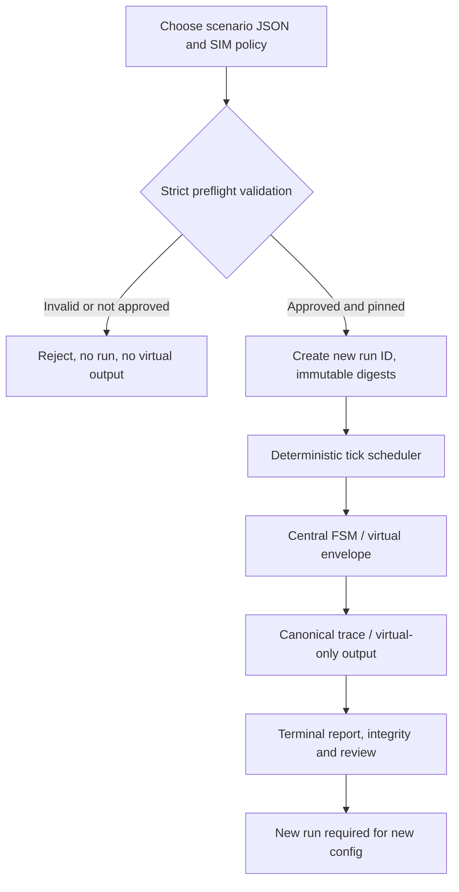

# BionicButterfly — Immutable Host Configuration, Capability Boundary & Change Governance

> **Phase 2.4 review note (2026-11-12):** See the candidate corrective addendum at the end and `84–90` before treating older priority/approval text as normative. **Pending owner approval; not code or flight authorization.**

- **ID:** BB-G0A-CFG-070 | **Rev:** 0.2 | **Date:** 2026-11-12
- **Status:** PROPOSED / PC_SIM_ONLY / NOT APPROVED. Refines `56`, `60`, `61`, `62`; no source files or storage code produced.

## 1. Narrower first implementation surface, if later approved

**Choose the narrow G0-A1 candidate:** select **one** `SimPolicyV1` and scenario before starting a run; validate both fully; freeze both digests throughout the run. There is no writable active configuration store and **no persistent profile mutation during a running simulation**, even if the virtual FSM is DISARMED. A change is a **new run ID** after finishing or aborting the previous run.

Rationale: deterministic evidence, no crash-safe persistence burden, no UI race when changing policy while ARM_CHECK, and simpler proof that a test cannot lift its own safety limits mid-run. This is stricter than the optional DISARMED-only update path proposed in `60`; both cannot be normative at once.

**Deferred:** atomic disk profile update with power-loss recovery; UI profile-edit workflow; remote calibration; multi-run profile management. `CFG-05` and `G1B-15` are marked `DEFERRED_OUT_OF_G0A1`, not claimed PASS.

## 2. Capability boundary and attack surface

| Caller / artifact | Allowed in host-only design | Forbidden |
|---|---|---|
| Local scenario JSON | submit virtual control frames, RF/power fault *stimuli*, BOOT, RESET, ACK; generate safe trace | replace policy or operation context, call GPIO, acquire flight authority |
| Preloaded `SimPolicy` | define SIM_ONLY virtual guards and output envelope **if explicitly approved and revision-pinned** | physical servo pulse, real RF/airborne profile, runtime context escalation |
| Host runner | validate, simulate, inspect traces; no device discovery required | `--hardware` or firmware-flash mode under this composition |
| Optional UI | edit *offline scenario text* or read immutable trace through app service | write virtual sink directly, upload safety policy mid-run, silently change active config |
| Domain core | pure typed input→state/decision/output computations | file IO, wall clock, network, ESP-IDF/Arduino, real timers or GPIO |

The implementation architecture must prevent real-hardware actuation **by composition/dependency policy**, not only by a runtime `if (SIM_ONLY)` flag. Host dependency manifest is reviewed against known hardware libraries/ports at G1 handoff. No physical USB/serial access is needed for G0-A1.

## 3. Configuration validation and approval fields

- Required: `schema_version=1`, `policy_id`, `model_tag=SIM_ONLY`, `allowed_context=PC_SIM`, numeric fields in `67`, `channel_map_revision`, `virtual profile identity`, and an **owner-approved design baseline** recorded separately.
- Enforce cross-field invariants: `0 <= neutral_flap_max < active_flap_threshold <= 1`; `0 <= neutral_steer_abs_max <= 1`; `0 < arm_low_observation_us <= arm_high_qualification_us < frame_timeout_us`; time fields multiples of 5,000us for this proposed v1, max scenario duration and count within quota. `rf_status_timeout_us` positive and bounded, integer microseconds. New code cannot silently supply missing values.
- Optional extras may contain *display metadata* only when explicitly allowlisted. Any physical-servo/IMU/flight-context field yields typed `E_CONTEXT_DENIED` or `E_PROFILE_INVALID`, not an ignored warning.
- Policy `approved_for_host_execution=false` is **not runnable for ARM/ACTUATION**. No source filename, user-controlled boolean or test fixture may self-certify an unapproved profile. Actual approval depends on a separately signed owner decision and exact revision/digest, with implementation enforcing that approved configuration set. A legacy `null` field for required numeric values is a fatal validation error.
- Scenario input is **data**, not a permission system: it may inject `SIM_RF_STATUS(HEALTHY)` but never assert physical `RC_PRIMARY` ownership, nor claim measured radio conditions. `rf_health` must carry provenance `INJECTED_SIM`.

## 4. Changing a design policy

1. SA opens a new proposed ADR with the previous decision/revision, change rationale, affected requirements and evidence.
2. Update `SimPolicy` proposal, schema/error definitions, state machine guards, test golden vectors and acceptance table **as one reviewed design change**.
3. Review impact on formerly approved G0-A1 core and G1 tests; no silent threshold change with the same `policy_id`.
4. Owner accepts exact Design revision and scope. Only then a *separate* user request may authorize a `Task/` for Developer work.
5. Later implementations must record the approved digest in every test trace; no runtime hot-swap allowed under G0-A1.

## 5. Control flow / data lifecycle

The arrow **approved and pinned** denotes a future gate; **none of the presently written candidate configs is approved**.

## 6. SA/Developer and repository boundaries

SA owns Design decisions and drafts, not implementation in `Source/`. Task files in `Task/` are only issued after the owner approves the bounded G0-A1 slice, and only if subsequently requested for implementation. Developer does not silently select unsafe defaults or port SIM policy into hardware firmware. PR review remains isolated under `ReviewPR/` per `11_HANDOFF_PR_WORKFLOW.md`. The owner decides when to commit/push; this phase performs neither.

**No G0-B/G0-C capability follows from an approved host-only configuration.**

## Phase 2.4 trusted policy approval amendment (rev 0.2)

No policy JSON boolean, profile name, user-provided digest, UI state or uploaded scenario can approve its own execution. `87` requires separately provisioned and authorized allowlist/digest tied to an **explicit owner approval of exact policy bytes** and a host-only engine build. No physical IO becomes accessible through flags. This is not implemented; G0-A1 approval pending.
