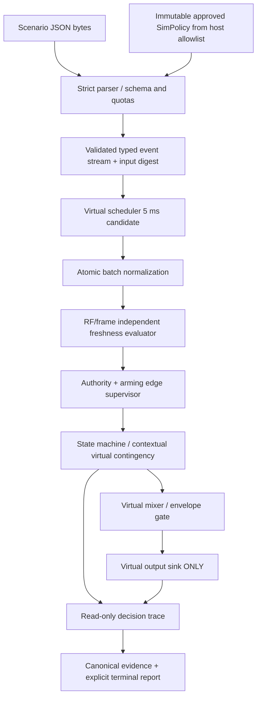

# BionicButterfly — G0-A1 End-to-End Host Control Path Review

- **ID:** BB-P23-E2E-076 | **Rev:** 0.1 | **Date:** 2026-11-12 | **Status:** PROPOSED / no executed G1 tests
- **Canonical context:** PC_SIM_ONLY, one source `SIMULATOR`, one immutable preloaded SIM policy, virtual actuator sink only. All real RC/UART/PWM/ESP32/battery/flight behavior is excluded.
- **Baseline:** `51`, `56–61`, `67–71`; user-confirmed product target RC real flight remains unchanged.

## 1. One-directional dependency graph

No packet, ISR, UI handler, scenario JSON field or callback may bypass `AuthorityManager`, `SafetySupervisor` or `EnvelopeGate`. No module in the composition exposes USB, serial port, servo HAL, radio transmitter, real clock, Wi-Fi or a physical-airborne signal. Host's virtual 5ms tick is not physical servo PWM.

## 2. Stage contracts and tests

| Stage | Consumes | Produces | Safety invariant | Corresponding proposed test |
|---|---|---|---|---|
| Parser/preflight | raw bytes, frozen schema | typed events or one explicit rejection | no executable state for duplicate keys, NaN, unknown fields/context | P22-T16/17, P23-T01/02 |
| Policy selection | independently approved preloaded policy | immutable verified `policy_digest` | scenario cannot set approval or physical permissions | P22-T15/16, P23-T03 |
| Scheduler | events with original `event_at_us` | eligible batch at aligned eval time | no early processing; one published decision per tick | P22-T08/19, P23-T04 |
| Normalizer | all event types at tick | stable classified batch, reason set | contradictory control cannot also count as valid disarm/arm without explicit adjudication | P23-T05/06 |
| RF & frame freshness | independent observations | status + age + provenance | serial valid != RF healthy; LOST not erased within same tick | P22-T12/13/22, P23-T07 |
| Authority/FSM | qualified normalized controls + faults | exactly one state / owner transition | held ARM high, recovery and wrong owner never autoarm | P22-T02…05/13/14, P23-T08/09 |
| Mixer/envelope | validated motion intent | bounded virtual `micro_effort` | no nonfinite/silent physical interpretation | P22-T07/21, P23-T10 |
| Evidence | snapshots + output status | canonical records, terminal status, hashes | incomplete evidence cannot be PASS | P22-T20, P23-T11/12 |

## 3. Event outcomes and provenance labels

- Input `flap_demand/steering_demand` are *requested* normalized intent, not servo shaft angle or aerodynamic lift.
- Virtual output `left_micro_effort=200000` means 0.2 normalized effort; it is not `200000 µs PWM`.
- `airborne_status=UNKNOWN`, physical current/servo angle/lift `null` or unavailable, not faked by simulator.
- `RF_HEALTHY` injected in scenario has provenance `INJECTED_SIM`, never real link proof.
- Trace records distinguish `VALIDATION_REJECTED`, `FAILED`, test-oracle-expected fault, `FAILED_INCOMPLETE_EVIDENCE`, `COMPLETE`. Test PASS and run outcome are separate types.

## 4. Illustrative low/arm/actuation/lost-link sequence (not executed)

Assuming *only* `SIM_POLICY_CANDIDATE_22A` and an **already authorized hypothetical host policy**: 0 BOOT ⇒ SELF_TEST; 5000 ⇒ DISARMED; 10000 RF HEALTHY; 15000 LOW; 35000 distinct LOW; 40000 HIGH neutral ⇒ ARM_CHECK; 140000 confirming HIGH neutral ⇒ ARMED_IDLE; 145000 separate active demand ⇒ ACTUATION_ACTIVE with bounded virtual output; 150000 RF LOST ⇒ CONTINGENCY with virtual output inhibited; restored HEALTHY at 160000 alone does not rearm. This mirrors `71` and is an **expected design trace, not real runtime evidence**.

## 5. Exception handling as an API contract

- **Before run:** malformed schema/duplicate event identifier/type/range/quotas → no engine execution and no virtual output, `VALIDATION_REJECTED`.
- **During run:** injected critical fault/timeout/conflict → atomic FSM policy, typed reasons; simulation log may record intentional contingency without calling the run safe-to-fly.
- **Write/export error:** terminal `FAILED_INCOMPLETE_EVIDENCE`, virtual sink inhibited; partial trace labeled, no PASS.
- **Resource exhaustion:** typed quota error; bounded stop, no false completion or partial trace disguised as a full record.

## 6. Architectural acceptance of G0-A1 review

A model and a documented trace example do not constitute a working simulator. Actual G1 requires a separately approved Developer task, code build, executed input vectors and evidence. Before G0-A1 signoff the SA must resolve `77` disputed semantics, `78` canonical API representation, `79` oracles, and repository access `75`; owner's approval is still pending.
