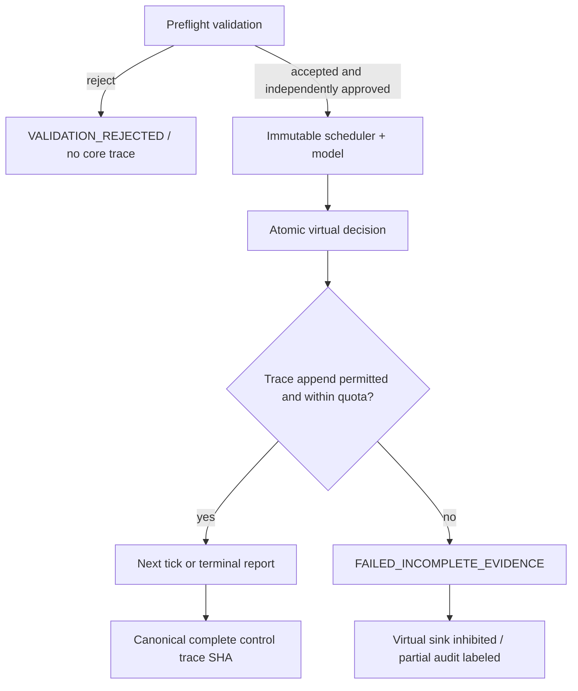

# BionicButterfly — Deterministic Replay Identity, Evidence & Audit Policy

- **ID:** BB-P23-EVID-080 | **Rev:** 0.1 | **Date:** 2026-11-12 | **Status:** PROPOSED
- **Design context:** strict JSON input and config v1 (`57`,`67`), canonical JSON RFC8785 candidate (`69`), virtual time, same approved engine/schedule only.

## 1. Avoid the run-id/hash paradox

A replay should have two different identifiers:

1. `replay_identity`: reproducible SHA-256 of version-tagged length-prefixed canonical scenario/config + exact deterministic engine/contract revision and scheduler step. Same approved inputs/build produce the **same** replay identity.
2. `execution_instance_id`: optional unique external tracking key (UUID/timestamp) used to distinguish separate invocations, **excluded from normative control trace**. It is never used for the arm protocol, force model or hash comparison.

The prior `run_id` should be frozen to mean either one of these, **not both**. The recommended deprecation is `run_id` = stable replay identity inside normative trace; user-facing execution instance belongs in external metadata only. This is an ADR proposal and not a backward-compatible implementation change already committed.

## 2. Canonical normative control trace

- Trace header: `schema_rev`, `approved_policy_digest`, `scenario_digest`, `engine_revision`, `scheduler_contract_revision`, `tick_step_us`, `replay_identity`, `scope=PC_SIM_ONLY`, output units `micro_effort`.
- Each evaluation record: monotonic integer `eval_at_us`, `state_before/after`, owner, separate valid-frame and RF status ages, sorted cause IDs and typed reasons, `output_allowed`, integer virtual L/R micro-effort or null if inhibited.
- Terminal record: exact status, declared completeness, decision count, time bound and whether any trace failure occurred. Do not mix test assertion PASS with run outcome.
- Excluded from normative bytes: wall clock, file path, host name, user name, locale, visualization-only interpolation, optional camera artwork, UI ordering, external case notes.
- JCS + LF-separated JSONL candidates. Canonicalizer must be tested against RFC8785 reference vectors; `json.dumps(sort_keys=True)` alone is not sufficient.
- SHA over canonical normative control trace bytes gives `control_trace_sha256`; if trace cannot be completed then **no valid complete trace SHA** is claimed (partial bytes may have separate explicitly named digest).

## 3. Failure and partial-evidence lifecycle

No crash/error can silently substitute last valid physical outputs because there are **no physical outputs in this composition**. The virtual sink is logically inhibited; a future hardware engine requires an entirely different response and safety gate.

## 4. Provenance requirements for every later acceptance run

`design_main_commit` (exact Git SHA, still unknown here), `design_review_id`, `policy_id`, canonical `policy_sha`, `scenario_sha`, `contract_rev`, `engine_rev`, `tick_us`, `replay_identity`, optional `execution_instance_id`, `test_id`, `expected_oracle_id`, `observed_result`, `control_trace_sha`, `evidence_complete`, `reviewer`. Reference screenshots/images can be attached but must not replace raw trace.

## 5. Baseline check and signing

A file SHA-256 is **integrity information**, not proof that the owner authorized a policy. Approval is a separate reviewed decision tied to exact bytes/revision. After the owner explicitly approves G0-A1, an allowlisted approved policy digest can be supplied to a future host implementation; **none is approved now**. `75` records the missing remote Git commit proof.
