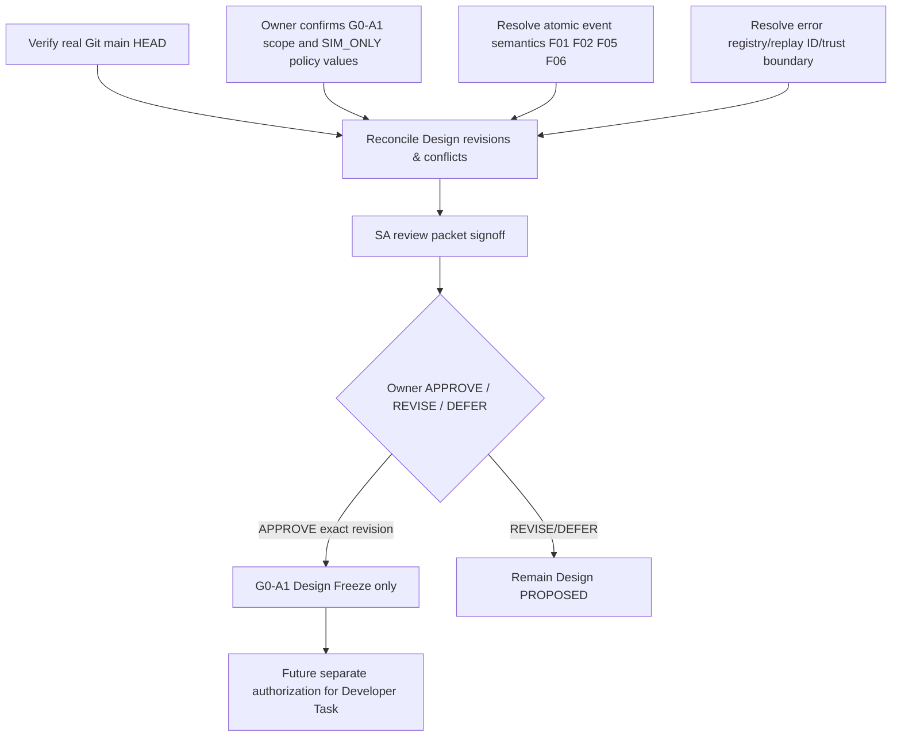

# BionicButterfly — Phase 2.3 SA Correction and Design-Control Plan

- **ID:** BB-P23-CORRECT-081 | **Rev:** 0.1 | **Date:** 2026-11-12 | **Status:** PROPOSED
- **Role constraint:** SA controls architecture/design only. No `Source/`, no `Task/`, no Git push, no PR claimed.

## 1. Source-of-truth corrections (proposal, not automatic edits)

| Source file | What needs to change | Why & test effect | G0-A1 decision dependency |
|---|---|---|---|
| `57_CANONICAL_SIM_SCHEMAS_AND_ERRORS.md` | clarify duplicate ID vs conflicting control batch errors; version error enum | F04; P23-T01/T05 | D-070 |
| `58_DETERMINISTIC_SAFETY_FSM_SEMANTICS.md` | clarify control conflict guard vs disarm; reset/fault priority and ACK timing | F01/F02/F06; P23-T05/07/09 | D-067/068/071 |
| `59_VIRTUAL_TIME_EVENT_REPLAY_SPEC.md` | original event timestamp vs atomic tick, no same-tick edge and no cross-tick identity | F10; P23-T04/10/20 | D-074 |
| `61_CORE_API_AND_SEQUENCE_DESIGN.md` | formalize trust-boundary for approved policy, total typed outcomes | F08; P23-T03 | D-072 |
| `67_SIM_ONLY_NUMERIC_POLICY_PROPOSAL.md` | remain SIM_ONLY and unapproved; policy examples not authority | F11; P23-T03 | D-072 |
| `68_ATOMIC_EVENT_AND_SAFETY_TRANSITION_CONTRACT.md` | canonical collision resolution, catastrophic reset and ACK ordering | F01/F02/F05/F06 | D-067/068/071 |
| `69_REPLAY_SERIALIZATION_AND_EVIDENCE_CONTRACT.md` | deterministic replay identity vs volatile invocation metadata; normative trace scope | F03/F07; P23-T11/18 | D-069 |
| `70_IMMUTABLE_CONFIG_AND_HOST_SCOPE_GATE.md` | host allowlist/approval trust anchor; clarify boolean non-authority | F08; P23-T03 | D-072 |
| `71_PHASE22_POLICY_BOUNDARY_TEST_ORACLES.md` | add disputed-edge vectors and conditional statuses; retain prior test IDs | F01/F02; P23-T05/07 | D-067/068 |
| `72_FREEZE_GAP_CLOSURE_AND_REPO_RECONCILIATION.md` | update with verified real Git HEAD when possible | F12; freeze FRZ-01 | D-066 |

**Do not overwrite the owner's existing files blindly.** First get actual HEAD and compare its contents, then propose controlled patches. This phase publishes additive files `75–83` only.

## 2. Decision dependency graph

## 3. Approval granularity

- Owner approval of `D-067…D-074` and `SIM_POLICY_CANDIDATE_22A` **only** makes host design eligible for freezing; does not approve purchase, servo power, actual RF handling or flight.
- Correcting source documentation is a distinct action from **executing code tests**. Any G1 run requires an approved developer implementation + actual evidence.
- Hardware/safety blockers CF-02/03/05/06/07/12/15 remain open; pitch/roll/yaw control and in-air failure behaviors unproven.

## 4. Hand-off boundary after a future owner approval

Only if owner explicitly accepts a specific review version and separately requests coding does SA create a bounded `Task/TASK-...md` naming exact Design files, constraints, expected test IDs and allowed directories. AI Developer cannot decide unresolved flight-safe values. PR should be checked in `ReviewPR/` isolated checkout; no code changes now.
